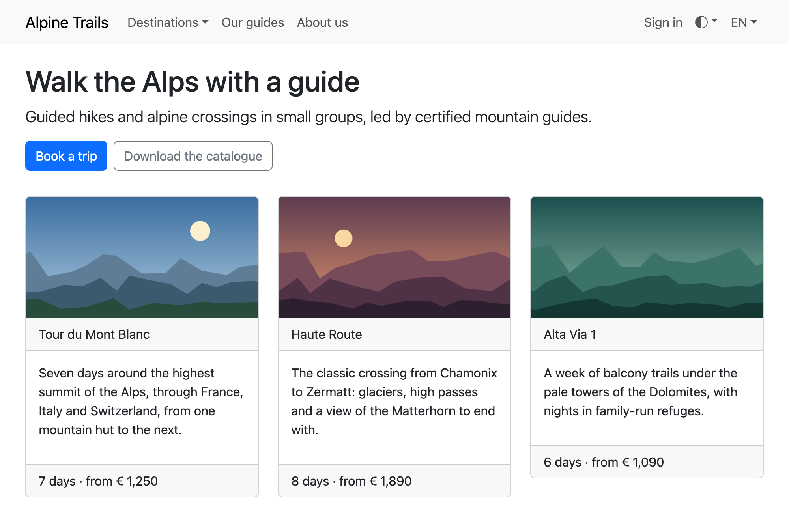
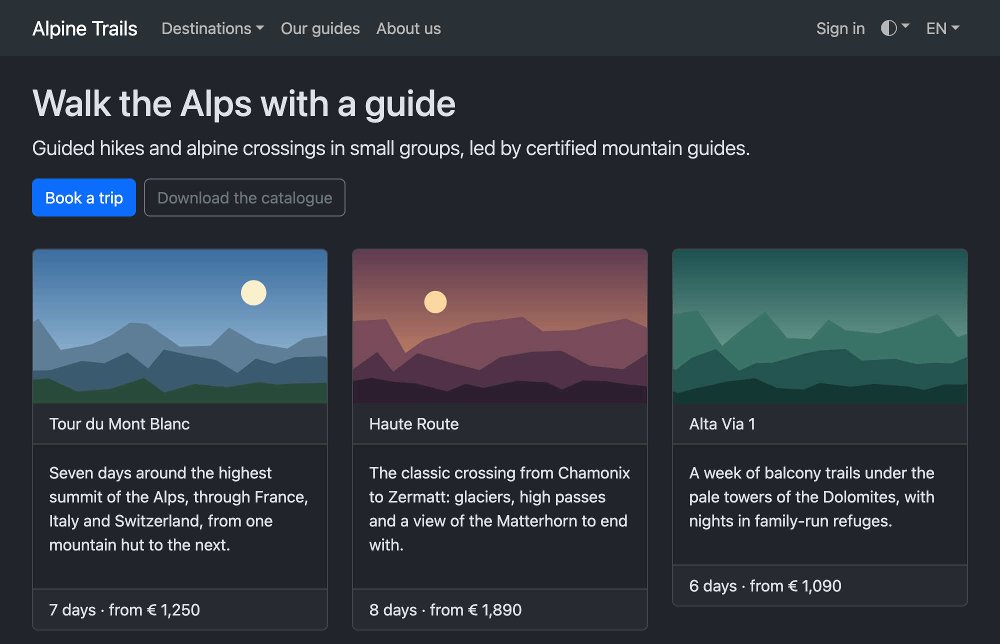
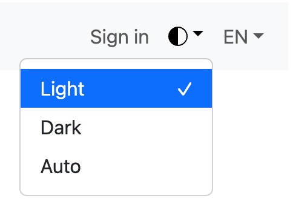

# Colour mode

A site can be displayed in a light or a dark colour mode. The mode changes the colours of the whole page: background, text, cards, menus and so on.

| Light | Dark |
|-------|------|
|  |  |

## The three modes

| Mode | What visitors see |
|------|-------------------|
| Light | A light background with dark text |
| Dark | A dark background with light text |
| Auto | Light or dark, following the setting of the visitor's device or browser. The page changes by itself when that setting changes |

## Default colour mode of the site

The default mode is what visitors get when they have not chosen one themselves.

1. Open the settings of the site.
2. In the group **Colour mode**, choose a value for **Default colour mode of the site**:
   - `Light`
   - `Dark`
   - `Automatic (follows the visitor's system setting)`
3. Save and publish.

If nothing is chosen, the site is light. The page templates of `bootstrap5-templates-starter` apply this default.

## Letting visitors choose

Tick **Show the colour mode switcher (light / dark / auto)** in the **Global settings** of the [Navbar](components/navbar.md). The navbar then shows a menu with Light, Dark and Auto.

The choice of a visitor is remembered in the browser, on that device. It wins over the default of the site the next time the visitor comes back. A visitor who clears the data of the browser gets the default again.

## Notes

- Check the colours you chose in both modes, in particular for text colours and backgrounds picked in the content editor: a colour that reads well on a light page may not on a dark one.
- Without the switcher in the navbar, visitors cannot change the mode, and the default of the site applies.
