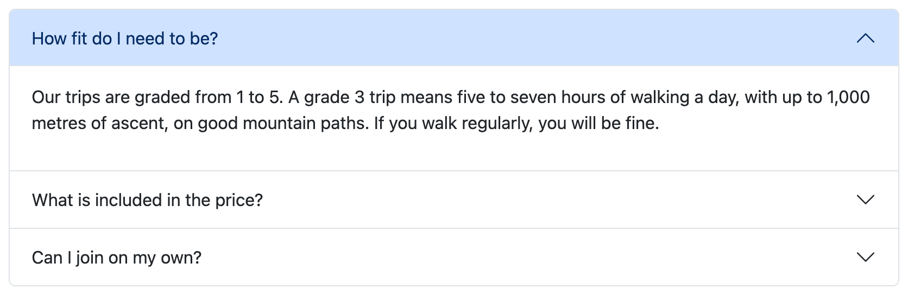
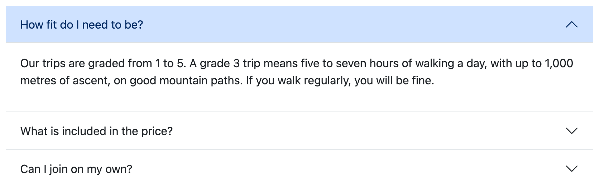

# Accordion

An accordion displays a list of collapsible panels. Only one panel (or several) can be open at a time.

## How to use

1. Add an **Accordions** component to your page area
2. Inside it, add one or more **Accordion panel** components
3. Each panel has a title (the clickable header) and a body (the collapsible content)

## Accordion properties

| Field | Description |
|-------|-------------|
| Flush style (removes outer borders and rounded corners) | Blends the accordion with its surrounding container |

## Accordion panel properties

| Field | Description |
|-------|-------------|
| Panel title | The clickable header label |
| Text | Rich-text body content |
| Start expanded | Start this panel in the expanded (open) state |

The body area also accepts any droppable content component — you are not limited to the rich-text field.
