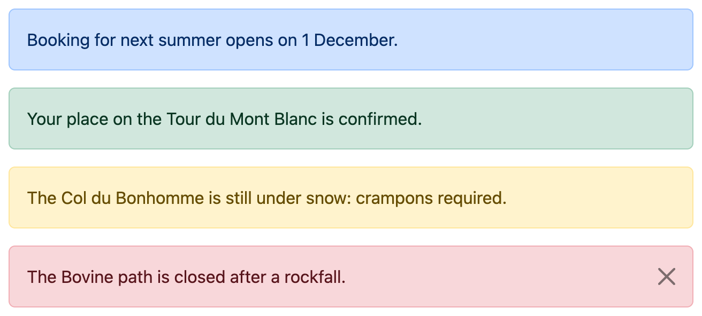

# Alert

An alert displays a contextual notification banner. It can optionally include a close button.

## Properties

| Field | Description |
|-------|-------------|
| Colour | `Primary`, `Secondary`, `Success`, `Info`, `Warning`, `Danger`, `Dark`, `Light`, `Link` or `Custom` |
| Allow dismissing (adds a close button) | Add a close button so visitors can hide the alert. It comes back when the page is loaded again |

## Body content

The alert body is a droppable area. Add any content component (text, button, etc.) inside it.

## Notes

- Alert is applied as a **skin** on a content container, not as a standalone component. Add content inside it as you would any other container.
- The colour carries a meaning: `Success` is green, `Warning` yellow, `Danger` red, `Info` light blue. Say it in the text too, because colour alone is not perceived by everyone.
- `Link` and `Custom` only have an effect if the style sheet of your site defines them.
- The close button uses Bootstrap 5's built-in dismiss mechanism and requires no extra JavaScript.
