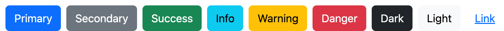
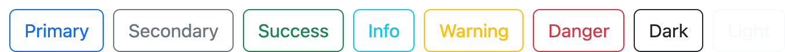
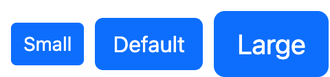
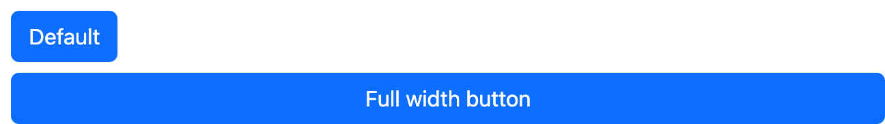
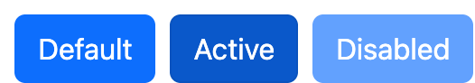
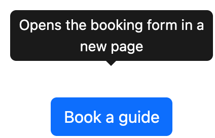
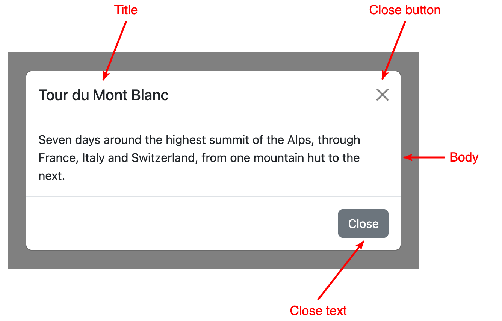
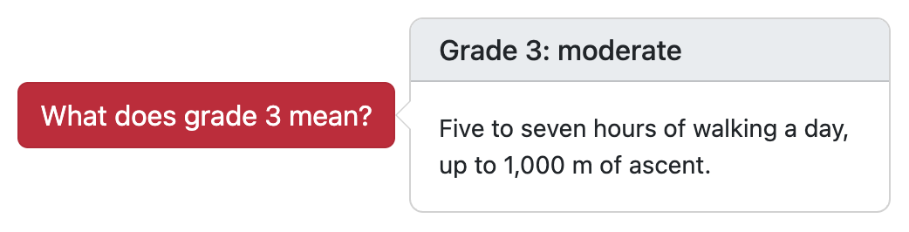
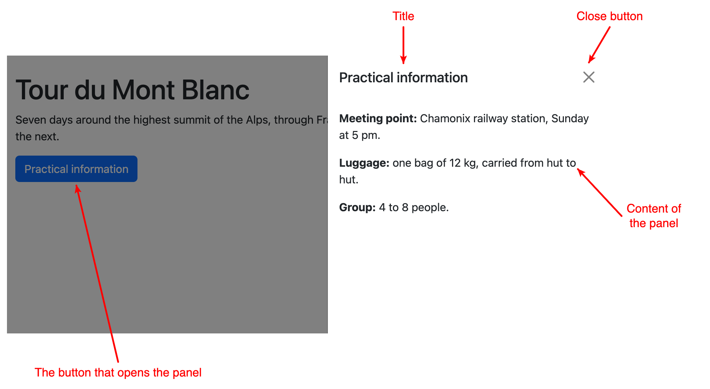

# Button

A button renders a styled link or interactive trigger. The button type determines what happens when clicked. To place several buttons together, use a [button group](button-group.md).

## Button types

Choose the **Action** first: it unlocks the relevant fields. If **Button text** is empty, an internal link shows the title of its target page and the other types show "Read more".

| Action | Behavior |
|--------|----------|
| Internal link | Links to a page or file within the Jahia site |
| External URL | Links to an arbitrary URL (`https://`, `mailto:` or `tel:`) |
| Modal | Opens a Bootstrap dialog overlay |
| Collapse | Shows/hides a collapsible content panel inline |
| Popover | Shows a small bubble next to the button |
| Offcanvas | Slides in a panel from the edge of the screen |

## Advanced settings

| Field | Description |
|-------|-------------|
| Style | Colour of the button: Primary, Secondary, Success, Info, Warning, Danger, Dark, Light, "No background (link style only)" or "Custom (use CSS class field)" |
| Size | `Default`, `Large` or `Small` |
| Outline style | Coloured border and text on a transparent background. Ignored with the link style |
| Full-width button | The button takes the whole width of its container |
| State | `Default`, `Active` (shown as pressed) or `Disabled` |
| CSS class(es) on this button | Additional CSS classes. With the Custom style, they are the only classes of the button |
| Prevent label from wrapping | The text stays on one line |
| Stretched link (makes the parent container fully clickable) | Clicking anywhere in the block that contains the button, a card for example, follows the link |
| Tooltip text (extra information, not a repeat of the label) | See [Tooltip](#tooltip) |
| Tooltip position | `Top`, `Bottom`, `Left` or `Right` |

## Tooltip

A tooltip is a small text shown when the button is pointed at or focused with the keyboard.

- Type the text in **Tooltip text** and choose where it appears with **Tooltip position**. Leave the text empty for no tooltip.
- The tooltip can be closed with the Escape key, and it stays open while it is pointed at.
- A tooltip is not shown on a Popover button (a button carries one bubble only) nor on a button whose state is Disabled (it cannot be focused).
- Touch screen users may never see a tooltip. Do not put essential information in it, and do not repeat the button text.

## Internal link fields

| Field | Description |
|-------|-------------|
| Button text | The button text |
| Link target | Pick a page or file from the site tree |

## External URL fields

| Field | Description |
|-------|-------------|
| Button text | The button text |
| URL | The target address, starting with `https://`. An e-mail (`mailto:`) or a phone number (`tel:`) also work |

## Modal fields

| Field | Description |
|-------|-------------|
| Button text | The button text that opens the modal |
| Modal title | The dialog heading. Without a title, the window has no header and no close cross |
| Close button label | Text of the button at the bottom of the window. "Close" if empty |
| Size | `Default (medium)`, `Small`, `Large` or `Extra large` |
| Static backdrop (clicking outside does not close) | The window only closes with its own buttons |
| Vertically centred | Center the dialog vertically in the viewport |

The modal body is a droppable area.

## Collapse fields

| Field | Description |
|-------|-------------|
| Button text | The button text |
| Start expanded | The content is visible when the page loads |

The collapse body is a droppable area.

## Popover fields

| Field | Description |
|-------|-------------|
| Button text | The button text |
| Popover title | The popover heading |
| Popover content | The popover body text |
| Placement | `Top`, `Bottom`, `Left` or `Right`. The bubble moves to another side when there is not enough room |
| Allow HTML in content (use with caution) | Render HTML tags in the content. Only tick it for content you wrote yourself |

## Offcanvas fields

| Field | Description |
|-------|-------------|
| Button text | The button text |
| Panel title | The offcanvas panel heading |
| Slide in from | `Start` (left in a left-to-right language), `End` (right in a left-to-right language), `Bottom` or `Top` |
| Show a backdrop behind the panel | Darken the page behind the panel |
| Allow page scrolling while panel is open | Let visitors scroll the page while the panel is open |

The offcanvas body is a droppable area.
