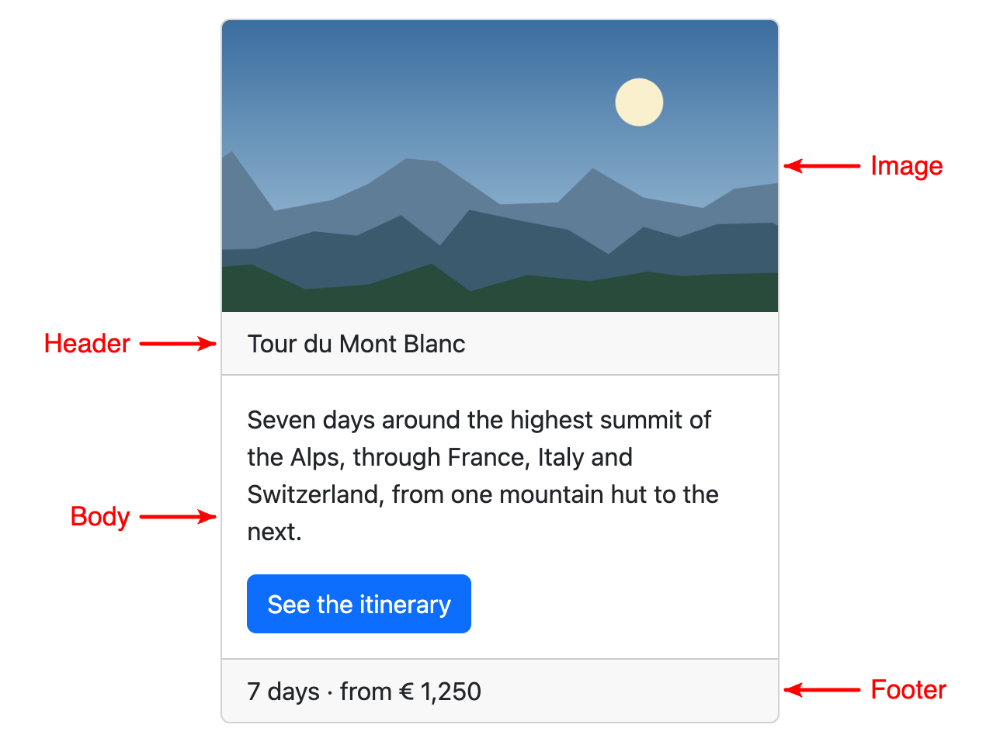

# Card

A card is a flexible content container with an optional image, header, body, and footer.

## Properties

| Field | Description |
|-------|-------------|
| Card title | Shown in the header of the card. Leave empty for a card without header |
| Title heading level | Level of the title in the outline of the page: `H1` to `H5`, or `Default (paragraph)`, a plain paragraph that is not a heading. It does not change the size of the text |
| Image | Pick an image from the media library. It is displayed above the header |
| Text alignment | `Start`, `Center` or `End` (the whole card). "Start" is the left in languages read from left to right |
| Footer text | Short text shown at the bottom of the card. For richer content, tick **Rich footer** in the advanced settings |

## Colors (Advanced settings, Colors group)

Check that the text stays readable on the chosen background.

| Field | Description |
|-------|-------------|
| Background | Card background. "Default" keeps the standard background of a card |
| Text | Card text colour. "Body" is the normal text colour of the site, "Muted" a lighter grey |
| Border | Card border |

## Advanced settings

| Field | Description |
|-------|-------------|
| CSS class(es) on the card wrapper | For integrators. Replaces the `card` class of the outer block: keep `card` in it unless you restyle the card entirely |
| CSS class(es) on the card header | For integrators. Replaces the `card-header` class |
| CSS class(es) on the card body | For integrators. Replaces the `card-body` class |
| Rich footer (drop any content into the footer area) | Replace the footer text with a droppable area |

## Body

The card body accepts any droppable content component.

## Notes

- If no image is selected, no image is rendered.
- Enabling **Rich footer** replaces the footer text with a droppable area.
