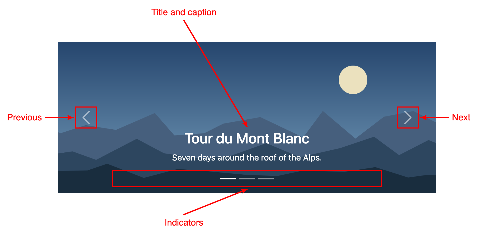

# Carousel

A carousel cycles through a set of slides. Each slide contains an image with an optional title and caption.

## How to use

1. Add a **Carousel** component
2. Add **Slide** components inside it (one per slide)
3. Reorder slides by dragging them in the content tree

## Carousel properties

| Field | Description |
|-------|-------------|
| Show slide indicators | Display clickable dots below the slides |
| Show previous / next controls | Display previous/next arrow buttons |
| Auto-play delay between slides (ms) | Time between automatic slide transitions (default: 5000) |
| Navigate with keyboard arrow keys | Allow keyboard arrow navigation |
| Pause on mouse hover | Stop auto-play when the mouse is over the carousel |
| Auto-play on page load | Start cycling automatically on load |
| Loop back to first slide | Cycle back to the first slide after the last |
| Cross-fade transition (instead of slide) | Use a fade transition instead of a slide |
| CSS class(es) on the carousel root element | Additional classes on the carousel element |
| Colour of the controls | `White (for dark images)` or `Dark (for light images)` |

## Slide properties

| Field | Description |
|-------|-------------|
| Image | Pick an image from the media library |
| Slide title | Slide heading (overlaid on the image) |
| Caption | Slide body text (overlaid below the title) |
| Title colour | Colour of the title text |
| Caption colour | Colour of the caption text |
| CSS class(es) on this slide | Additional classes on this slide |
| Per-slide delay (ms, overrides carousel setting) | Override the global interval for this slide only |
