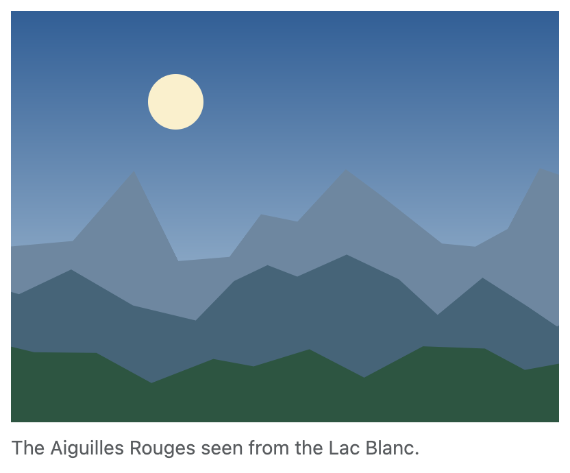
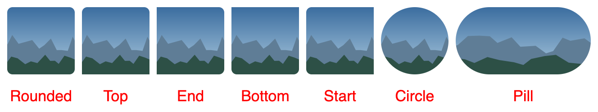
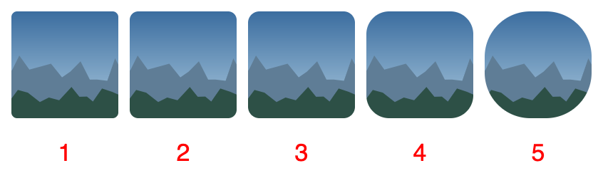

# Figure

A figure renders an image with an optional caption.

## Properties

| Field | Description |
|-------|-------------|
| Image | Pick an image from the media library |
| Caption | Caption text displayed below the image |

## Image advanced settings

| Field | Description |
|-------|-------------|
| CSS class(es) on the image | Additional classes on the `` element |
| Inline style on the image | Inline CSS on the `` element |
| HTML id on the image | HTML id attribute |
| Responsive (img-fluid — scales with container) | Add `img-fluid` (scales with container width) |
| Thumbnail style (img-thumbnail — adds a border) | Add `img-thumbnail` — see below |
| Alignment | `Default`, `Start` (float at the start), `End` (float at the end) or `Center` (centered block) |
| Alt text (overrides asset default) | Accessibility description (falls back to image display name) |
| Border radius shape | `None`, `Rounded (all corners)`, `Top corners only`, `End corners only`, `Bottom corners only`, `Start corners only`, `Circle` or `Pill` |
| Border radius size | `Default`, `None`, `Small`, `Medium`, `Large`, `Extra large` or `Largest` (Bootstrap sizes 0 to 5) |

## Caption alignment

| Field | Description |
|-------|-------------|
| Alignment | `Start`, `Center` or `End` |

## Notes

- If no caption is set, no `<figcaption>` is rendered.
- The image URL is resolved automatically from the JCR media library.
