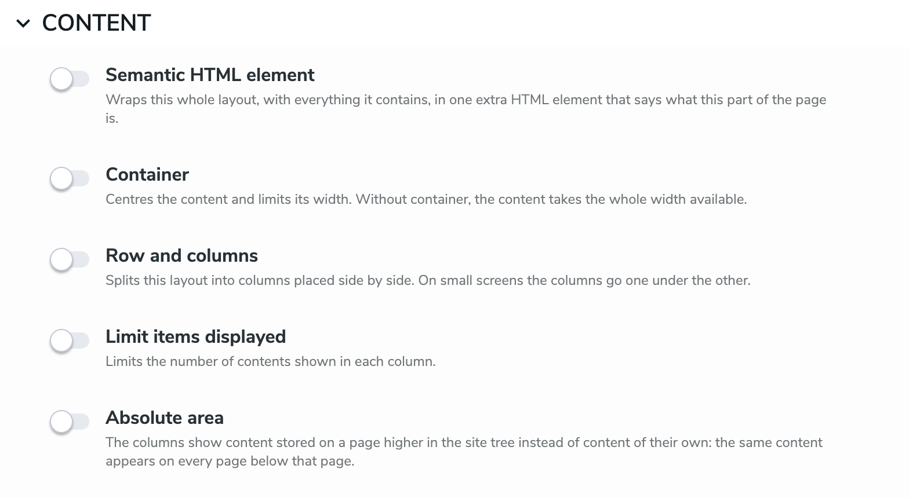
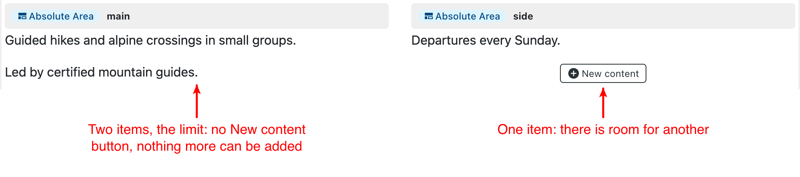

# Grid

The Grid component is the primary layout building block. It can act as a semantic section wrapper, a Bootstrap container, a multi-column row, or a set of shared content areas.

In the content editor, the Grid lists five toggles. Switch on the ones you need; each one adds its own fields.

| Toggle | What it does |
|--------|--------------|
| Semantic HTML element | Wraps the content in an HTML element that says what this part of the page is |
| Container | Centres the content and limits its width |
| Row and columns | Splits the layout into columns |
| Limit items displayed | Limits the number of contents shown in each column |
| Absolute area | Shows content stored on a page higher in the site tree |

## Modes

### Semantic HTML element

Wraps this layout, with everything it contains, in one extra HTML element. Choose it for its meaning.

| Field | Description |
|-------|-------------|
| HTML element type | `section` (a thematic part), `article` (a self-contained piece), `aside` (side content), `nav` (navigation), `header` and `footer` (top and bottom of a block), `main` (main content of the page, one per page), `hgroup`, `figure`, `figcaption`, or `div` when no meaning applies |
| HTML id attribute | Optional. Lets a link jump to this part of the page (address ending with `#identifier`). Letters, digits, dashes and underscores only; unique on the page |
| CSS class(es) | Optional. For integrators |
| Inline style | Optional. For integrators: CSS declarations applied to this element only |
| ARIA role (e.g. banner, main, navigation) | Optional, for accessibility specialists. Only needed with a `div` |
| ARIA label (aria-label attribute) | Optional. A short name read by screen readers, for example "Latest news". Not displayed |

### Container

Centres the content and limits its width. Without a container, the content takes the whole width available.

| Field | Description |
|-------|-------------|
| Container width | `Fixed width`, `Fluid (100% width at all sizes)`, or "Full width up to 576 / 768 / 992 / 1200 / 1400 px, then fixed width" (Small, Medium, Large, X-Large, XX-Large) |
| HTML id attribute | Optional. Same rules as above |
| Extra CSS class(es) | Optional. For integrators |

### Row and columns

Splits this layout into columns placed side by side. On small screens the columns go one under the other. A droppable area is created for each column.

| Field | Description |
|-------|-------------|
| Column layout | `Empty row (no columns)`: one single area. `Predefined layout`: choose among ready-made column widths. `Custom layout`: define each column with Bootstrap classes |
| HTML id attribute | Optional. Same rules as above |
| Extra CSS class(es) on the row | Optional. For integrators |
| Vertical alignment of columns | `Default` (all columns get the height of the tallest), `Top`, `Middle`, `Bottom` |
| Horizontal distribution of columns | `Default`, `Start`, `Center`, `End`, `Around`, `Between`, `Evenly`. No visible effect when the columns fill the row, as the predefined layouts do |
| Horizontal gutter (space between columns) | `Default` (about 24 pixels), `None`, then `1` to `5` for wider and wider space |
| Vertical gutter (space between column rows) | `Default` (no space), `None`, then `1` to `5`. Applies when columns go under one another |

#### Predefined layout

Each number is the width of a column; a full row is 12. With `Predefined layout`, a second **Column layout** field lists the presets:

| Preset | Columns |
|--------|---------|
| 12 (full width) | One column |
| 6 / 6 | Two equal halves |
| 4 / 8 | One-third / two-thirds |
| 8 / 4 | Two-thirds / one-third |
| 3 / 9 | One-quarter / three-quarters |
| 9 / 3 | Three-quarters / one-quarter |
| 4 / 4 / 4 | Three equal thirds |
| 3 / 6 / 3 | Narrow / wide / narrow |
| 3 / 3 / 3 / 3 | Four equal quarters |
| 10 / 2 | Large / narrow |
| 2 / 10 | Narrow / large |

#### Custom layout

| Field | Description |
|-------|-------------|
| Column classes | For integrators. One entry per column, separated by commas; each entry holds the Bootstrap classes of that column. Example: `col col-md-8,col-6 col-md-4` gives two columns |

### Absolute area

The columns show content stored on a page higher in the site tree instead of content of their own: the same content appears on every page below that page. Typical use: a grid in a footer.

| Field | Description |
|-------|-------------|
| Inherit content from ancestor level | `0 - Home page`, or `1` to `5` for the pages below it. The content is edited on that page only; on the pages below it is displayed and cannot be changed |

### Limit items displayed

Limits the number of contents shown in each column.

| Field | Description |
|-------|-------------|
| Maximum items | `No limit`, `1`, `2`, `3`, `4`, `5` or `10`. Contents beyond this number are not displayed, and editors cannot add more |

## Notes

- Grid toggles are not mutually exclusive: a section wrapper can contain a container which contains a row.
- Nest Grid components to build complex layouts.
- "Start" and "End" follow the reading direction; see [Right-to-left languages](../right-to-left.md).
