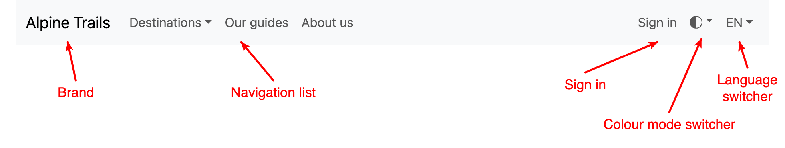
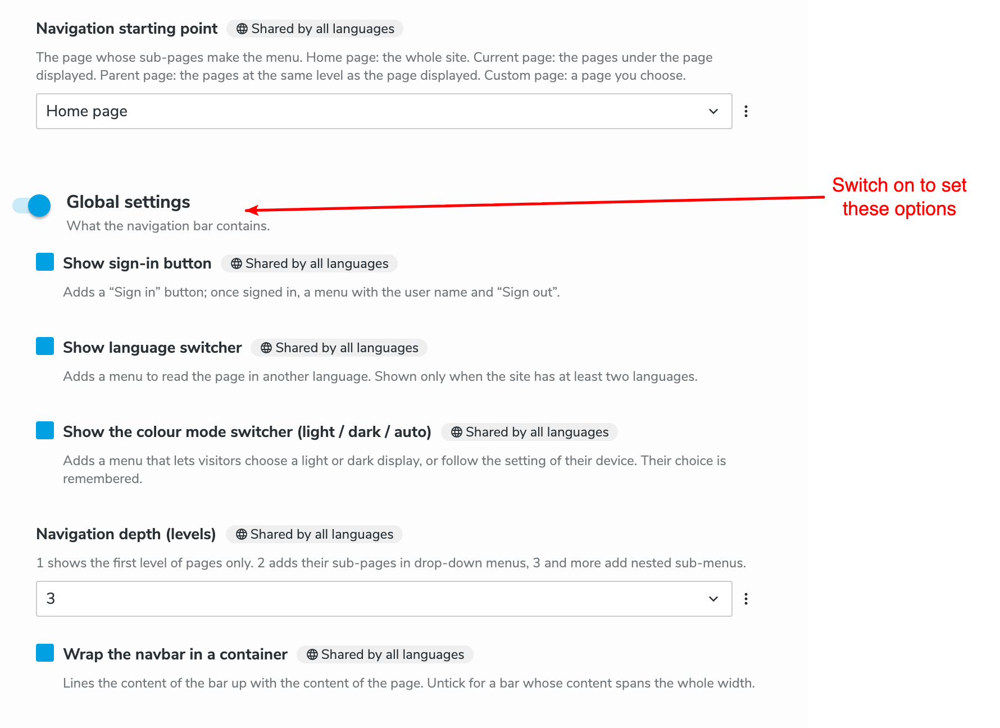
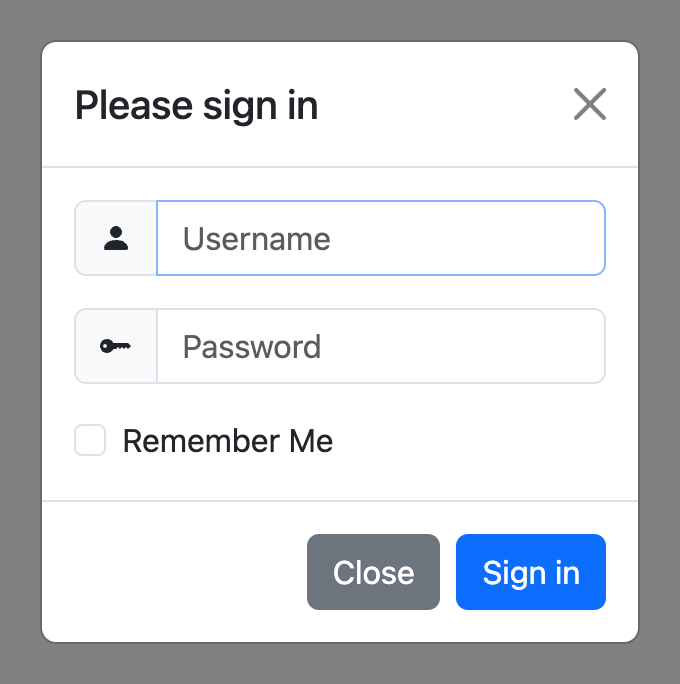
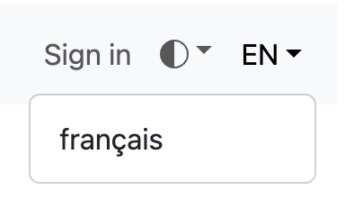
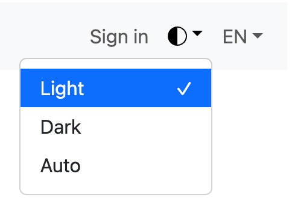
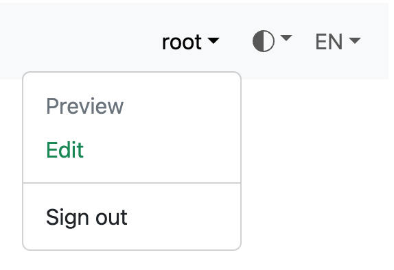
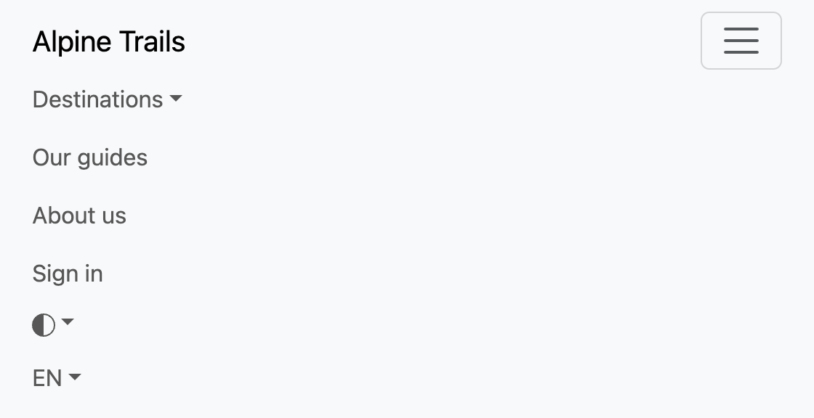
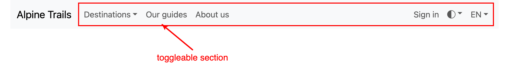
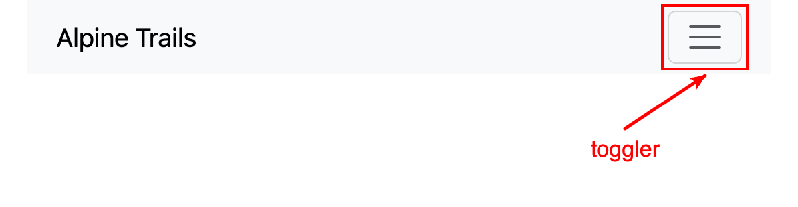
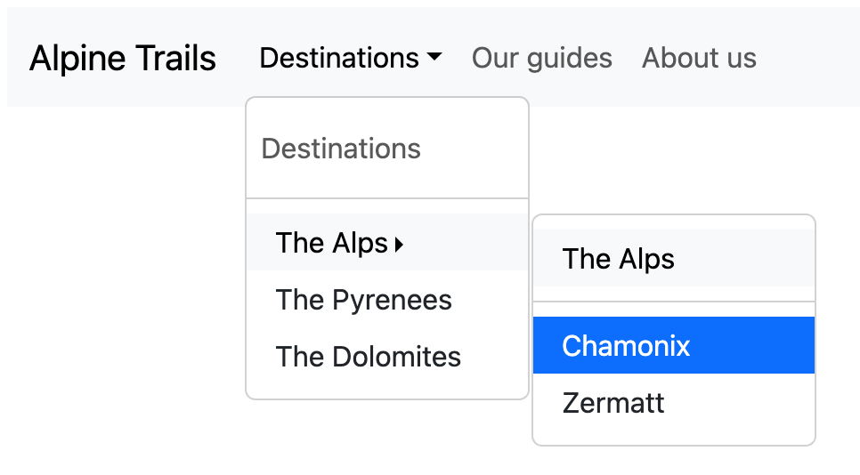

# Navbar

The Navbar renders the site navigation header: the brand logo or name, the page menu, and optionally a sign-in button, a language switcher and a colour mode switcher.

## Properties

### Navigation starting point

| Field | Description |
|-------|-------------|
| Navigation starting point | `Home page` (the whole site), `Current page` (the pages under the page displayed), `Parent page` (the pages at the same level as the page displayed) or `Custom page` |
| Starting page | (shown when the starting point is `Custom page`) Picker to select the page whose sub-pages make the menu |

### Brand

The group is titled **Customize brand**.

| Field | Description |
|-------|-------------|
| Brand text | The site name displayed next to the logo |
| Brand logo (desktop) | Logo image |
| Brand logo (mobile / small screens) | Optional. Shown instead of the desktop logo while the menu is folded |

> **Note:** A brand can also be set at the **site level** (group **Brand** in the site settings). A site-level brand replaces the brand set on each navbar.

### Global settings

| Field | Description |
|-------|-------------|
| Show sign-in button | Adds a "Sign in" button. Once signed in, it becomes a menu with the user name and "Sign out" |
| Show language switcher | Adds a menu to read the page in another language. Shown only when the site has at least two languages |
| Show the colour mode switcher (light / dark / auto) | Adds a menu that lets visitors choose a light or dark display, or follow the setting of their device. See [Colour mode](../color-mode.md) |
| Navigation depth (levels) | `1` to `5`. 1 shows the first level of pages only; 2 adds their sub-pages in drop-down menus; 3 and more add nested sub-menus |
| Wrap the navbar in a container | Lines the content of the bar up with the content of the page. Untick for a bar whose content spans the whole width |

### Customize CSS classes

For integrators. Empty fields use the Bootstrap defaults.

| Field | Description |
|-------|-------------|
| Class(es) on the `<nav>` element | Colours and the screen size from which the menu is displayed in full. `navbar-expand-lg` unfolds it on large screens; `bg-body-tertiary` follows the dark mode |
| Class(es) on the mobile toggle button | The hamburger button |
| Class(es) on the brand text link | The brand name |
| Class(es) on the brand image link | The brand logo |
| Class(es) on the collapsible section | The part that folds on small screens |
| Class(es) on the navigation list | The `<ul>` of the menu |
| Class(es) on each list item | Each menu entry |
| Class(es) on each navigation link | Each link |
| Class(es) on the sign-in / language list | The list holding the sign-in, colour mode and language menus |

## Notes

- The menu is built automatically from the page hierarchy, starting at the chosen starting point.
- Only pages with **Display in menu** enabled appear in the navbar.
- The current page receives the `active` CSS class, and its ancestors receive `inpath`.
- In a drop-down menu, the parent page is listed first, above a divider, so that visitors can still open it. Pages of the third level open in a side sub-menu. Sub-menus can be opened with the keyboard.
- The language menu lists the other languages by their own name (for example "français").

### Colour mode switcher

The switcher is a half-filled circle button. Its menu offers Light, Dark and Auto, and shows a check mark next to the mode in use.

### Signed-in menu

In edit mode and for signed-in users, the user name opens a menu with the modes available to the user (for example Preview and Edit) and "Sign out".

### On small screens

The menu collapses and is revealed by a hamburger button. The sign-in, colour mode and language menus then appear in the folded list, under the pages.

