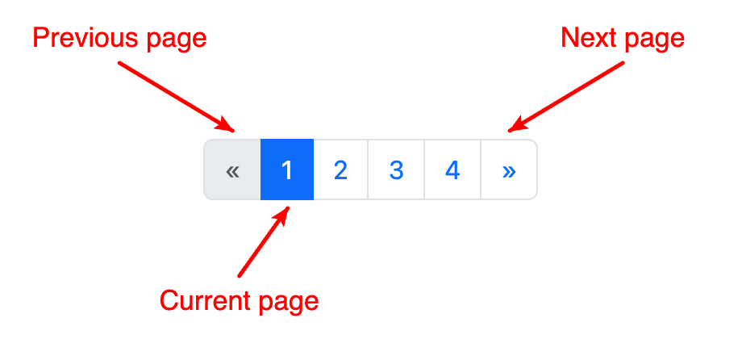
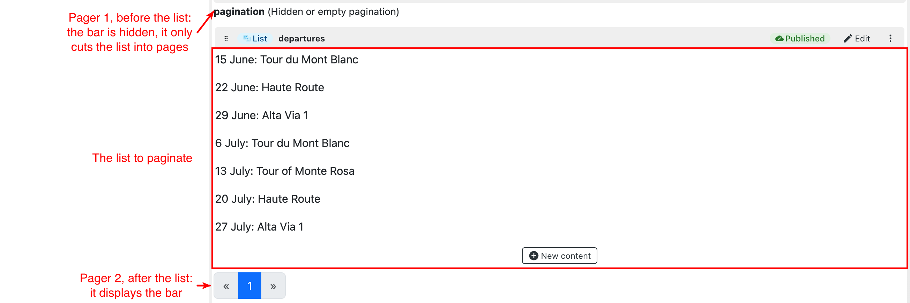
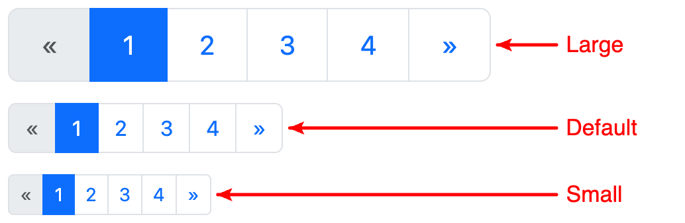
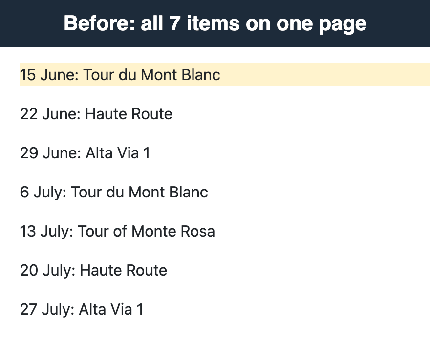
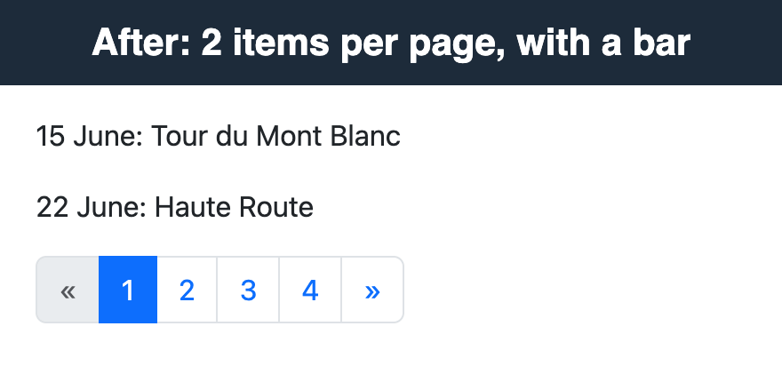

# Pagination

The Pagination component renders a Bootstrap pagination bar bound to a content list on the same page. Visitors can navigate through the list page by page.

## Properties

| Field | Description |
|-------|-------------|
| Display the pagination bar | Show the pagination bar. Unticked, the list is still cut into pages but visitors get no links to the other pages |

## Advanced settings

| Field | Description |
|-------|-------------|
| Items per page | Number of items per page. Default: 10 |
| Number of page links shown in the bar | Beyond this number, the bar only shows the pages around the current one. Default: 10 |
| Items per page (edit mode cap) | While editing, the list shows this many items so that you can reach them all without changing page. Default: 100 |
| Alignment | `Start`, `Center` or `End` |
| Size | `Large`, `Default` or `Small` |

## Notes

- The Pagination component must be **bound** to a content list on the same page using the Jahia binding mechanism. The bound list controls which content is paginated; Pagination only renders the navigation bar.
- Place the pager **before** the list it pages, as in 2.x. This is how the first page is limited without any parameter in the address of the page.
- Visitors move between pages with the links of the bar; the bar writes the position and the page size in the address of the page.
- The bar is a labelled navigation block, and disabled entries are not links.

