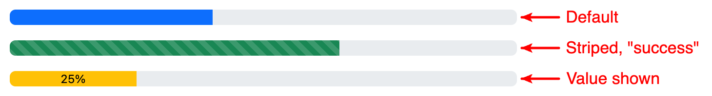

# Progress bar

A progress bar shows how far something has gone, for example funds raised or places booked.

## Properties

| Field | Description |
|-------|-------------|
| Description for screen readers (what the bar measures, e.g. "Funds raised") | Not displayed. Tells screen reader users what the bar measures |
| Value (how far the bar is filled) | The current value. Default: 0 |
| Maximum (value of a full bar) | The value of a full bar. Default: 100 |
| Colour | `Default`, `Success`, `Info`, `Warning` or `Danger` |
| Striped | Add diagonal stripes to the filled part |
| Show the percentage in the bar | Print the filled share of the bar, for example `25%` |

## Notes

- The bar is filled in proportion: a value of 30 with a maximum of 120 fills a quarter of the bar.
- The colour carries no meaning for people who cannot see it. Say what the bar measures in the description field, and show the percentage when the exact figure matters.
