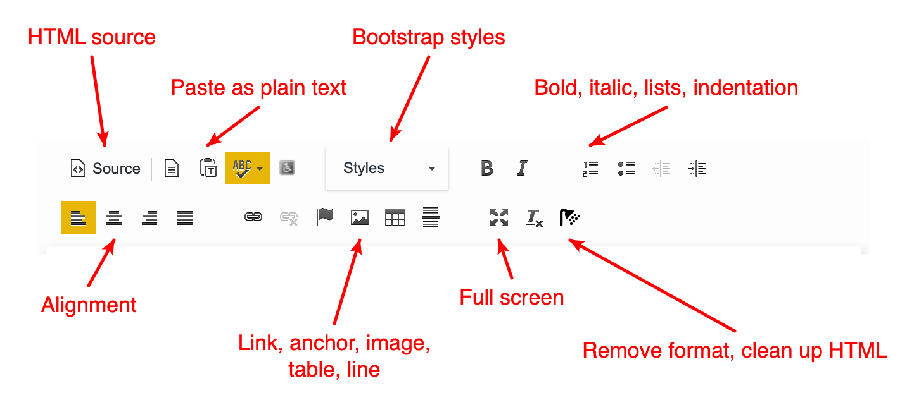

# Text

The Text component renders a rich-text block.

## Properties

| Field | Description |
|-------|-------------|
| Text | Rich-text content, edited with a compact toolbar |

## Editors

Two editors can edit the field. Both offer the same Bootstrap styles.

### CKEditor 4 (default)

CKEditor 4 is used unless CKEditor 5 is enabled for the site (see below). Its toolbar holds:

- **Source**, **Templates**, **Paste as text**, spell checking, the accessibility checker and the **Styles** list.
- Bold and italic, numbered and bulleted lists, indent and outdent.
- Left, centre, right and justified alignment.
- Link, unlink, anchor, image, **Table** and horizontal rule.
- Maximize, remove format and **Wash HTML** (cleans the pasted HTML).

The **Styles** list offers:

- Headings 1 to 6, lead paragraph, highlighted, deleted, underlined, bold and italic text, blockquote, code, inline code and inline quote.
- Text colours and background colours (Primary, Secondary, Success, Info, Warning, Danger, Light, Dark).
- Alerts and badges in the same eight colours.
- Table styles: Table, Striped, Bordered, Hover and Compact. Apply them to a table inserted with the **Table** button.

The **Templates** list inserts ready-made blocks: code blocks, an alert in each of the eight colours, a table, a description list, blockquotes, a jumbotron and a card.

Every table gets the `table` class that Bootstrap needs to style it, when it is loaded in the editor and when it is saved.

### CKEditor 5

When the Jahia module `richtext-ckeditor5` is installed and enabled for the site, the Text field uses CKEditor 5. The administrator enables it per site: see [Rich text editor (CKEditor 5)](../../sysadmin/installation.md#rich-text-editor-ckeditor-5).

CKEditor 5 offers the Bootstrap styles in its style list: lead paragraph, highlighted text, blockquote, underlined text, inline code, text colours, background colours, alerts, badges and the five table styles. As in CKEditor 4, every table gets the `table` class.

## Notes

- The HTML produced by the editor is rendered directly. Standard Bootstrap typographic styles apply automatically.
- Alerts and badges inserted from the styles list are part of the text. For an alert with its own content area and a close button, use the [Alert](alert.md) skin.
- For layout, wrap Text components inside a Grid.
