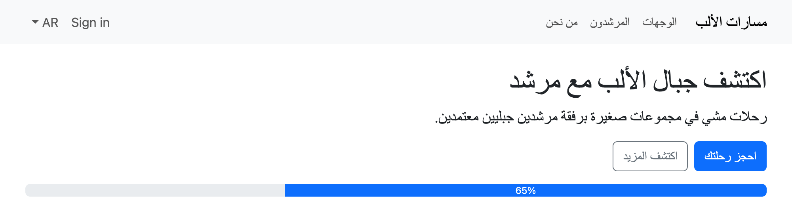

# Right-to-left languages

A page in a language written from right to left, such as Arabic or Hebrew, is mirrored automatically. You do not set anything: the language of the page decides.

## What changes

- The text is aligned to the right and the page reads from right to left.
- The navigation bar, the cards, the buttons and the other components are mirrored. In the picture, the brand and the menu are on the right, and the sign-in and language menus on the left.
- The page loads Bootstrap's right-to-left stylesheet in place of the usual one.

## Start and End

Options named **Start** and **End** follow the reading direction. In a left-to-right language, Start is the left side and End is the right side; in a right-to-left language, they swap. This applies to the alignment of text, images and tab bars, to the sides of paddings and margins, and to the **Slide in from** option of an offcanvas panel.

You can therefore build a page once and publish it in both kinds of languages. Prefer Start and End to a fixed left and right whenever you have the choice.
